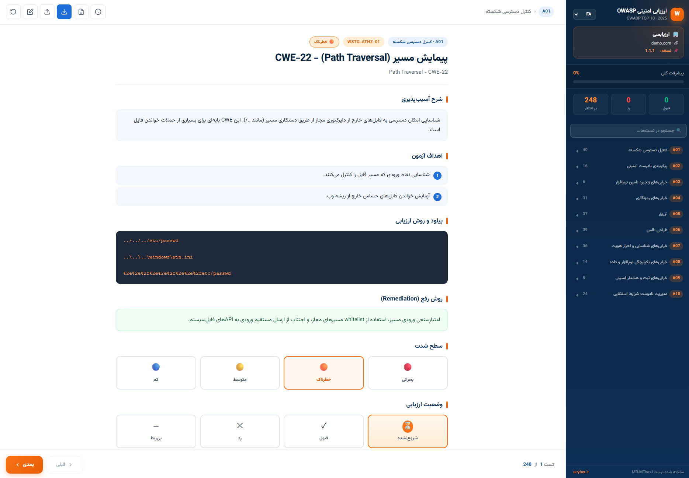
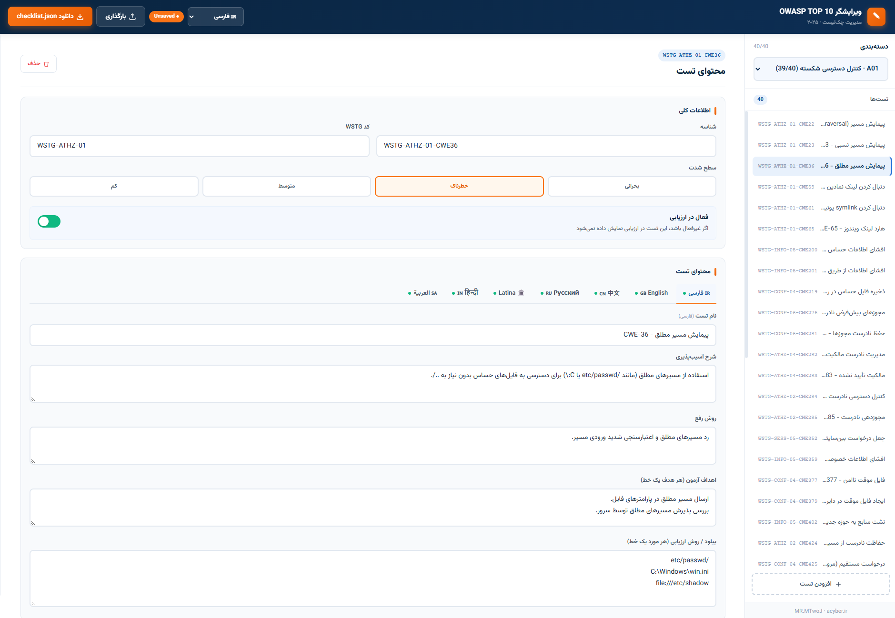

<!-- تصاویر اصلی بالای صفحه (بنرها یا اسکرین‌شات‌های ابزار) -->

  
  

# 🛡️ OWASP WSTG Assessment Suite & Checklist Studio
### ابزار جامع ارزیابی امنیتی و استودیو مدیریت چک‌لیست OWASP
### أداة تقييم الأمان ومحرر قوائم التحقق الشاملة
### OWASP WSTG 安全评估工具与检查清单编辑器
### Комплексный инструмент оценки безопасности и редактор чек-листов

 

<!-- منوی انتخاب زبان به صورت گرافیکی و دکمه‌ای -->

  <b>🌍 Choose your language / انتخاب زبان / اختر لغتك / 选择语言 / Выберите язык:</b>

  
  
  
  
  

 

<!-- بج‌های وضعیت پروژه -->

  
  
  
  
  

---

## 👨‍💻 توسعه‌دهنده و تیم سازنده (Author)

این پروژه با دقت، اشتیاق و تمرکز بر استانداردهای امنیت سایبری توسط **محمدجواد جوشانی (MR.MTwoJ)** توسعه یافته است.

* **GitHub:** [@MR.MTwoJ](https://github.com/mrmtwoj)
* **وب‌سایت / آزمایشگاه ارزیابی امنیتی:** [acyber.ir](https://acyber.ir)

---

